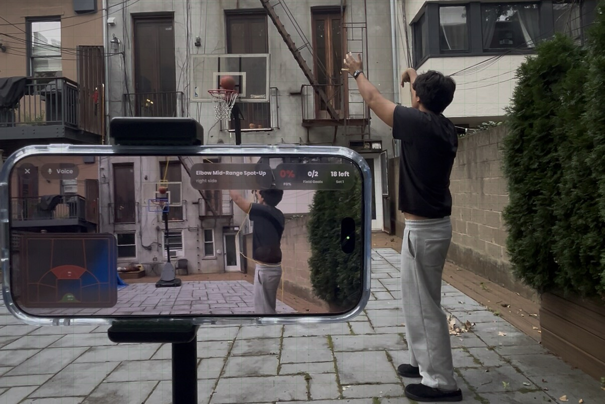
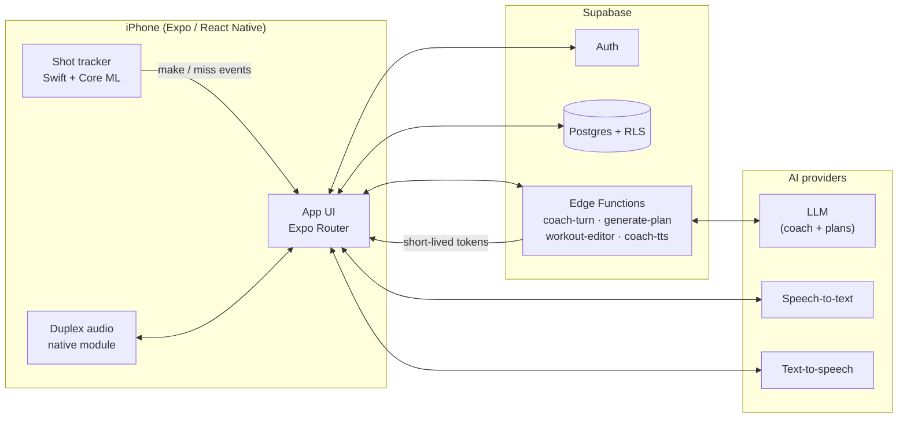

<div align="center">


# Court Coach

**An AI basketball trainer that watches your shots, talks you through every drill, and builds your training plan.**

<h1>
  <a href="https://apps.apple.com/us/app/court-coach-ai-hoops-trainer/id6789691200">📲 Download Court Coach on the App Store</a>
</h1>

<a href="https://apps.apple.com/us/app/court-coach-ai-hoops-trainer/id6789691200">
  
</a>




</div>

---

## Overview

Court Coach turns a phone into a basketball trainer. After a short onboarding questionnaire, it builds a personalized multi-week plan from a curated catalog of drill videos. During a workout, the coach runs the session hands-free:

- **Video Coach** sets the phone up courtside, tracks every shot with an on-device Core ML model, and gives spoken feedback after each attempt.
- **Voice Coach** works without the camera: you say "make" or "miss" and talk to the coach as you go.

Camera frames are processed live on the device for shot tracking and are never recorded or uploaded.

## Features

| | |
|---|---|
| 🎯 **On-device shot tracking** | A custom YOLO model running in Core ML detects the ball and rim, follows each shot's arc, and scores makes and misses in real time. |
| 🎙️ **Real-time voice coaching** | Streaming speech-to-text, an LLM coach with tool calling, and low-latency text-to-speech, with barge-in support so you can interrupt. |
| 🗓️ **AI training plans** | Plans are generated from your skill level, goals, weaknesses, and court access, and built only from real catalog drills. |
| ✏️ **Conversational workout editing** | Ask the coach to add, swap, or reorder drills mid-workout, or edit the plan with AI or by hand. |
| 📊 **Analytics and shot maps** | Shooting percentage by zone, heat maps, streaks, workout history, and shareable stat cards. |
| 🏆 **Achievements** | Milestones for consistency, volume, and shooting mastery. |
| 🔒 **Privacy first** | Shot tracking stays on device, and every table is protected by row-level security. |

## Architecture



Provider API keys stay on the server. The app requests short-lived session tokens from Edge Functions, and per-user daily usage budgets are enforced in Postgres.

## Tech stack

| Layer | Technology |
|---|---|
| Mobile app | Expo SDK 57, React Native 0.86 (New Architecture), Expo Router, TypeScript |
| Native modules | Swift: Core ML shot tracker, duplex audio engine, streaming PCM player (Nitro Modules) |
| Backend | Supabase Auth, Postgres with row-level security, Deno Edge Functions |
| AI | Anthropic and OpenAI models for coaching and plan generation; Cartesia, Deepgram, AssemblyAI, and Inworld for speech |
| Payments | RevenueCat |
| Delivery | EAS Build, EAS Update (over-the-air updates) |

## Repository layout

```text
.
├── frontend/                  Expo React Native app
│   ├── app/                   Screens (Expo Router file-based routes)
│   ├── components/            UI components (VideoCoachView, CoachOverlay, …)
│   ├── lib/                   Realtime coach engine, speech clients, analytics
│   ├── modules/               Native modules (shot tracker, duplex audio, PCM player)
│   └── assets/                Images, fonts, packaged coach audio
├── supabase/
│   ├── functions/             Edge Functions (coach-turn, generate-plan, workout-editor, …)
│   ├── migrations/            Postgres schema, RLS policies, RPCs
│   └── seed/                  Drill catalog import and metadata scripts
├── shared/coach/              Coach tool definitions shared by client and server
├── scripts/                   Coach tool code generation and evaluation
└── docs/                      Design and rollout notes
```

## Getting started

### Prerequisites

- Node.js and npm
- Xcode (the app uses custom native modules, so it needs a development build rather than Expo Go)
- [Supabase CLI](https://supabase.com/docs/guides/cli) and [Deno](https://deno.com/)
- An [Expo](https://expo.dev/) account for EAS builds

### 1. Configure environment variables

```bash
cp frontend/.env.example frontend/.env
cp supabase/.env.example supabase/.env
```

| File | Variable | Purpose |
|---|---|---|
| `frontend/.env` | `EXPO_PUBLIC_SUPABASE_URL` | Supabase project URL |
| `frontend/.env` | `EXPO_PUBLIC_SUPABASE_ANON_KEY` | Public anon key |
| `frontend/.env` | `EXPO_PUBLIC_REVENUECAT_IOS_API_KEY` | RevenueCat public SDK key |
| `supabase/.env` | `SUPABASE_URL`, `SUPABASE_SERVICE_ROLE_KEY` | Seed scripts only. Never ship these in the app. |

AI provider keys are stored as Supabase secrets, not in `.env` files:

```bash
supabase secrets set \
  ANTHROPIC_API_KEY=... OPENAI_API_KEY=... \
  CARTESIA_API_KEY=... DEEPGRAM_API_KEY=... \
  ASSEMBLYAI_API_KEY=... INWORLD_API_KEY=...
```

### 2. Set up the backend

```bash
supabase link --project-ref <your-project-ref>
supabase db push                       # apply migrations
supabase functions deploy              # deploy all Edge Functions

cd supabase && npm install
npm run seed:videos                    # import the drill catalog
npm run seed:metadata                  # apply drill descriptions and coaching notes
```

### 3. Run the app

```bash
cd frontend
npm install
npm run build:dev:ios                  # one-time EAS development build
npm run start:dev-client               # start Metro for the dev client
```

## Testing

```bash
# Edge Function tests (Deno): coach routing, usage budgets, provider auth
cd supabase && deno test functions/_shared

# App tests (tsx), one file at a time: speech protocols, shot intent, coach engine
cd frontend && npx tsx lib/cartesia/protocol.test.ts

# Lint
cd frontend && npm run lint
```

## Deployment

| Task | Command (from `frontend/`) |
|---|---|
| TestFlight build | `npm run build:testflight:ios`, then `npm run submit:testflight` |
| Production build | `npm run build:production:ios`, then `npm run submit:production` |
| OTA update (staging) | `npm run update:staging` |
| OTA update (production) | `npm run update:production` |

Changes to native code (anything under `frontend/modules/`) need a new binary build. JavaScript-only changes can ship as an OTA update.

---

<div align="center">

© 2026 Ryder Hornbeck. All rights reserved.

</div>
